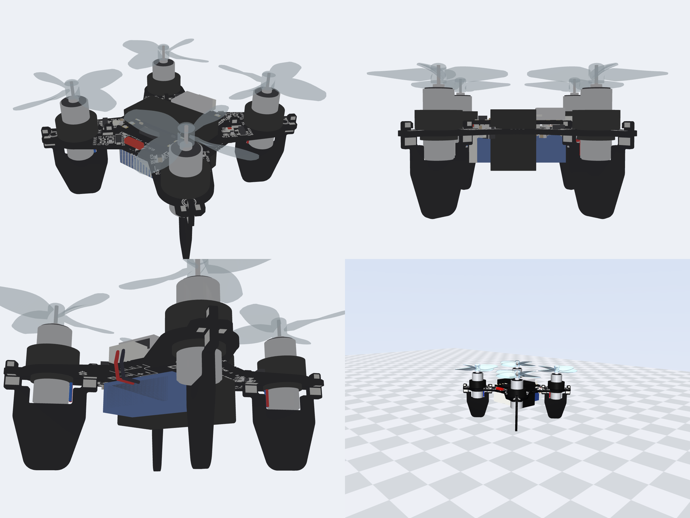

# E1 Nano ROS: ESP32 mini-drone swarms with ROS 2 and Zenoh

[](https://github.com/verlab/e1_nano_ros/actions/workflows/ci.yml)
[](https://verlab.github.io/e1_nano_ros/)
[](https://verlab.github.io/e1_nano_ros/viewer/)


[](LICENSE)

Driver, firmware, simulators and motion-capture integration for the **Cherglow E1 Nano**
([open hardware](https://oshwhub.com/songge8/project_fnvbukbz)), a 50 mm, 25 g quadrotor with an
ESP32-S3 that runs the open [CF-Drone](https://github.com/songge8/CF-Drone) flight firmware.

<p align="center">
  <a href="https://verlab.github.io/e1_nano_ros/viewer/"></a>
</p>

https://github.com/verlab/e1_nano_ros/raw/main/docs/assets/swarm_demo.mp4

> Six drones in MuJoCo: takeoff, two-level grid, rotating circle and landing. Each simulated drone runs the
> CF-Drone controller and receives commands over the same protocol as the real drones.
> **[Open the interactive 3D viewer →](https://verlab.github.io/e1_nano_ros/viewer/)**

## Features

| | |
|---|---|
| **Zenoh end to end** | The drone runs `zenoh-pico` and ROS 2 runs `rmw_zenoh_cpp`. Drones, simulator, ROS nodes and Python scripts share **one router**, with no micro-ROS agent per robot and no O(N²) DDS discovery over WiFi. [Why Zenoh?](docs/middleware.md) |
| **One driver for the whole swarm** | `e1_bridge` discovers drones automatically and gives each one `/e1_<id>/…` topics, TF, IMU, battery, arm/mode/parameter/console services, plus a global emergency stop. |
| **Simulation = hardware** | `e1-sim` (MuJoCo or Genesis) runs a Python port of the CF-Drone controller and speaks the same binary protocol, so code tested in simulation flies unchanged. |
| **Motion capture** | `e1_mocap` is a pure-Python **OptiTrack NatNet** client (NatNet 3.x/4.x, multicast or unicast, Y/Z-up) with tracking diagnostics. Any `PoseStamped` source also works. The simulator can act as a fake Motive to rehearse the real pipeline. |
| **Heading alignment** | The drone has no magnetometer, so its onboard yaw drifts away from the mocap yaw. `YawAlign` rotates every attitude command into the onboard frame. In simulation, tracking with a 25° heading error improves from 0.7 m to under 5 cm. |
| **Position control for N drones** | `e1_control`: `takeoff`/`land`/`goto`, streaming setpoints, minimum separation between drones, example missions. |
| **Two firmware variants** | `e1_nano`: CF-Drone + **E1 Zenoh link**. `e1_nano_stock`: upstream CF-Drone only (web RC, MAVLink). Merged binaries for each variant are attached to every release. |
| **Model from the real PCB** | URDF (ROS/Gazebo), MJCF (MuJoCo) and Genesis URDF with exact dimensions: 50.0 mm motor-to-motor, 50.9 × 50.9 × 1.2 mm board, mass and inertia computed from the meshes. |
| **Tooling** | Docker Compose, CI (pytest, colcon on Jazzy and Kilted, ROS smoke tests with and without mocap, four firmware builds), MkDocs site with a 3D viewer, wiki, seven-part tutorial. |

## Repository layout

```
e1_nano_ros/
├── e1_core/          # Python core without ROS: protocol, CF-Drone port, control, client, simulators, NatNet/mocap
├── e1_msgs/          # ROS 2 messages and services
├── e1_description/   # URDF / MJCF / Genesis URDF / meshes (model of the real PCB)
├── e1_bridge/        # ROS 2 <-> Zenoh driver (one process for the swarm)
├── e1_control/       # swarm position control + missions
├── e1_mocap/         # OptiTrack NatNet -> /e1_<id>/mocap/pose
├── e1_bringup/       # launch: simulation, real flight, Zenoh router, RViz
├── firmware/         # CF-Drone (submodule) + E1 Zenoh link (zenoh-pico), PlatformIO, stock and Zenoh variants
├── examples/         # plain Python scripts (square, formation, offline video)
├── tools/            # web_trajectories.py: records simulator runs for the 3D viewer
├── docker/ compose.yaml
├── docs/ mkdocs.yml  # site + 3D viewer (GitHub Pages)
└── wiki/             # pages synced to the GitHub wiki
```

## Quick start

### Docker

```bash
git clone --recursive https://github.com/verlab/e1_nano_ros.git && cd e1_nano_ros
docker compose build
E1_N=4 docker compose --profile demo up router sim bridge controller mission
```

### Native ROS 2 (Jazzy / Kilted)

```bash
sudo apt install ros-$ROS_DISTRO-rmw-zenoh-cpp ros-$ROS_DISTRO-robot-state-publisher ros-$ROS_DISTRO-rviz2
mkdir -p ~/e1_ws/src && cd ~/e1_ws/src && git clone --recursive https://github.com/verlab/e1_nano_ros.git
pip install -r e1_nano_ros/e1_core/requirements.txt
cd ~/e1_ws && colcon build --symlink-install && source install/setup.bash
export RMW_IMPLEMENTATION=rmw_zenoh_cpp
ros2 launch e1_bringup sim.launch.py num:=4 mission:=formation
# rehearse the mocap pipeline: fake OptiTrack + e1_mocap + onboard heading error
ros2 launch e1_bringup sim.launch.py num:=2 mocap:=true yaw_offset:=60 yaw_drift:=1
```

### Python only, no ROS

```bash
pip install -e "e1_core[sim,zenoh]" && export E1_DESCRIPTION_DIR=$PWD/e1_description
e1-sim -n 6 --mode peer --listen tcp/127.0.0.1:7447 --connect "" &
python3 examples/swarm_formation.py --n 6
```

### Real drones with OptiTrack

```bash
# 1. firmware (or flash a release binary: esptool --chip esp32s3 write-flash 0x0 e1_nano-merged.bin)
cd firmware && pio run -e e1_nano -t upload
#    in the drone console:  sta <ssid> <password> ; p WIFI_MODE 2 ; zn id 1 ; zn connect tcp/<pc-ip>:7447 ; reboot
# 2. Motive: one rigid body per drone named e1_<id>, Up axis = Z, streaming on
# 3. router + NatNet + driver + controller + RViz
ros2 launch e1_bringup real.launch.py ids:="[1]" mocap:=natnet server_ip:=<motive-ip> local_ip:=<this-pc-ip>
ros2 service call /e1_1/takeoff e1_msgs/srv/Takeoff "{height: 0.4, duration: 3.0}"
ros2 service call /e1/emergency_stop std_srvs/srv/Trigger     # or: e1-cli estop
```

Before the first flight, read [Motion capture](docs/mocap.md) and [Flight safety](docs/safety.md).

## Firmware variants

| Env | Board | Contents |
|---|---|---|
| `e1_nano` | ESP32-S3 SuperMini (E1 Nano v1.5Y) | CF-Drone + E1 Zenoh link: ROS 2, swarms, mocap |
| `e1_nano_stock` | ESP32-S3 SuperMini | upstream CF-Drone: phone/web RC, MAVLink |
| `e1_mini`, `e1_mini_stock` | classic ESP32 (E1 MINI) | same two variants |

CF-Drone stays unmodified as a git submodule. `firmware/tools/prepare_src.py` adds the Zenoh link through one include and five
anchored one-line hooks and fails the build if an upstream change moves an anchor. See [Firmware](docs/firmware.md).

## Interface (summary)

| ROS 2 (`/e1_<id>/...`) | Zenoh (`e1/<id>/...`) | |
|---|---|---|
| `state` `FlightState` · `imu` · `battery` · `pose` · `odom` · TF | `state` (50 Hz) · `pose` | telemetry |
| `cmd/attitude` `AttitudeTarget` | `cmd/attitude` | attitude + thrust (AUTO) |
| `setpoint` `PositionTarget` · `takeoff` · `land` · `goto` | (position loop on the ground) | position |
| `arm` · `set_mode` · `set_param` · `console` | `cmd/arm` · `cmd/mode` · `cmd/param` · `cmd/console` | management |
| `mocap/pose` (from `e1_mocap`) · `/e1/mocap/status` | | motion capture |
| `/e1/emergency_stop` · `/e1/swarm_status` | `e1/all/cmd/arm` · `e1/*/alive` | swarm |

Full reference: [ROS 2 API](docs/ros-api.md) · [Zenoh protocol](docs/protocol.md).

## Documentation

* Site: **https://verlab.github.io/e1_nano_ros/** · 3D viewer: **https://verlab.github.io/e1_nano_ros/viewer/**
* Tutorial: [1 Simulation](docs/tutorial/01-simulation.md) · [2 ROS 2](docs/tutorial/02-ros2.md) ·
  [3 Firmware](docs/tutorial/03-firmware.md) · [4 Real flight](docs/tutorial/04-real-flight.md) ·
  [5 Swarm](docs/tutorial/05-swarm.md) · [6 Genesis/RL](docs/tutorial/06-genesis.md) ·
  [7 Your own controller](docs/tutorial/07-controller.md)
* [Architecture](docs/architecture.md) · [Middleware](docs/middleware.md) · [Motion capture](docs/mocap.md) ·
  [Hardware](docs/hardware.md) · [Simulation](docs/simulation.md) · [Safety](docs/safety.md) · [FAQ](docs/faq.md)

## Tests

```bash
cd e1_core && E1_DESCRIPTION_DIR=$PWD/../e1_description python3 -m pytest -q
```

The 22 tests cover the protocol (sizes match the C header), hover and square tracking (< 10 cm), four drones,
the command-loss failsafe, the emergency-stop broadcast, takeoff and landing over Zenoh, NatNet encoding and decoding
(3.0–4.1), Y-up/Z-up conversion, the NatNet client and server, the mocap → Zenoh relay, and heading alignment.
CI also builds the ROS packages on Jazzy and Kilted and flies simulated drones through the full ROS pipeline, once with
ground-truth poses and once through the fake OptiTrack with a 60° heading error.

## Status

| Part | Status |
|---|---|
| `e1_core` (protocol, firmware port, control, client, MuJoCo/Genesis, NatNet) | tested (pytest, end to end over Zenoh) |
| ROS 2 packages (`e1_bridge`, `e1_control`, `e1_mocap`, `e1_bringup`) | built and smoke-tested in CI (`ros:jazzy`, `ros:kilted`) |
| `e1_mocap` against a real Motive | **pending**: tested against the built-in NatNet server only |
| Firmware (E1 Zenoh link) | compiles on the host against zenoh-pico 1.10.1 and CF-Drone `83ebe61`; ESP32 builds in CI; **hardware test pending** |
| Motor/propeller constants | estimated: identify your own |

## Credits and licenses

* E1 Nano hardware and CF-Drone firmware: **琛光科技 / Cherglow (songge8)**. Hardware under CC BY-NC-SA 4.0;
  CF-Drone under GPL-3.0 with a commercial-use restriction. The combined firmware (`firmware/`) follows those terms.
* This repository (ROS 2 packages, `e1_core`, docs, viewer): **Apache-2.0** ([`LICENSE`](LICENSE)). The 3D model
  (`e1_description`) derives from the open PCB: **CC BY-NC-SA 4.0** ([`e1_description/LICENSE.md`](e1_description/LICENSE.md)).
* Developed at **VeRLab, DCC/UFMG**.
