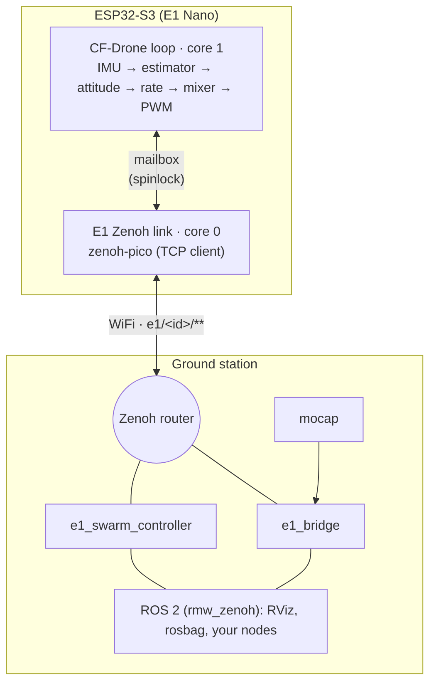

# Architecture

## Responsibilities

| Layer | Runs on | Rate | Function |
|---|---|---|---|
| Stabilization | firmware (CF-Drone) | ~1 kHz | attitude estimation, attitude and rate PIDs, mixer, failsafes |
| Link | firmware (E1 Zenoh link) | 50 Hz | telemetry, commands, discovery, command-stream failsafe |
| Position | PC (`e1_core.control`) | 50 Hz | position PID with *feed-forward*, attitude + thrust output |
| Planning / swarm | PC | 1–50 Hz | trajectories, formations, missions |
| ROS driver | PC (`e1_bridge`) | — | Zenoh ↔ topics/services/TF |

From the firmware's point of view, the simulator is just another source of `e1/<id>/**`. `e1-sim` runs the
CF-Drone port (`e1_core.firmware`), a first-order motor model (τ = 20 ms), a battery model and the physics
of MuJoCo (1 kHz) or Genesis.

## Frames

* `world` (ENU) → `e1_<id>/base_link` (FLU, origin at the PCB center, mid-plane) → `e1_<id>/rotor_*`.
* `imu_link`: MPU-6500, 7.1 mm forward of the center, under the ESP32 module.

## Timing and latency (estimates; measure them in your lab)

| segment | latency |
|---|---|
| mocap → ROS | 2–5 ms |
| ROS → bridge → Zenoh → WiFi → drone | 3–10 ms |
| command applied in the next firmware cycle | ≤ 1 ms |
| **total position loop** | **≈ 10–20 ms** (adequate for 50 Hz) |
