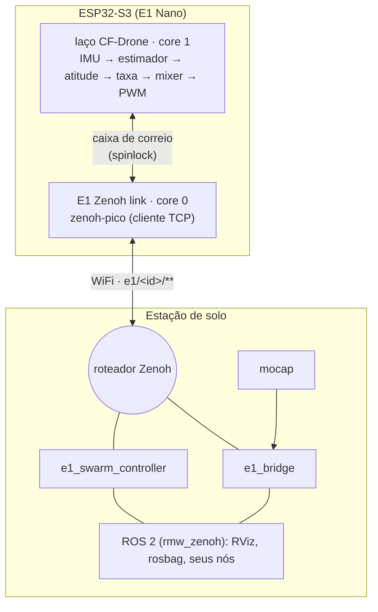

# Arquitetura

## Responsabilidades

| Camada | Onde roda | Frequência | Faz |
|---|---|---|---|
| Estabilização | firmware (CF-Drone) | ~1 kHz | estimação de atitude, PIDs de atitude e taxa, mixer, failsafes |
| Link | firmware (E1 Zenoh link) | 50 Hz | telemetria, comandos, descoberta, failsafe de fluxo |
| Posição | PC (`e1_core.control`) | 50 Hz | PID de posição com *feed-forward*, atitude + empuxo |
| Planejamento / enxame | PC | 1–50 Hz | trajetórias, formações, missões |
| Driver ROS | PC (`e1_bridge`) | — | Zenoh ↔ tópicos/serviços/TF |

Para o firmware, a simulação é só mais uma fonte de `e1/<id>/**`. O `e1-sim` executa o porte do
CF-Drone (`e1_core.firmware`), um modelo de motor de 1ª ordem (τ = 20 ms), um modelo de bateria e a física
do MuJoCo (1 kHz) ou do Genesis.

## Frames

* `world` (ENU) → `e1_<id>/base_link` (FLU, origem no centro do PCB, plano médio) → `e1_<id>/rotor_*`.
* `imu_link`: MPU-6500, 7,1 mm à frente do centro, sob o módulo ESP32.

## Tempo e latência (estimativas, a medir no seu laboratório)

| trecho | latência |
|---|---|
| mocap → ROS | 2–5 ms |
| ROS → bridge → Zenoh → WiFi → drone | 3–10 ms |
| comando aplicado no próximo ciclo do firmware | ≤ 1 ms |
| **total da malha de posição** | **≈ 10–20 ms** (adequado para 50 Hz) |
