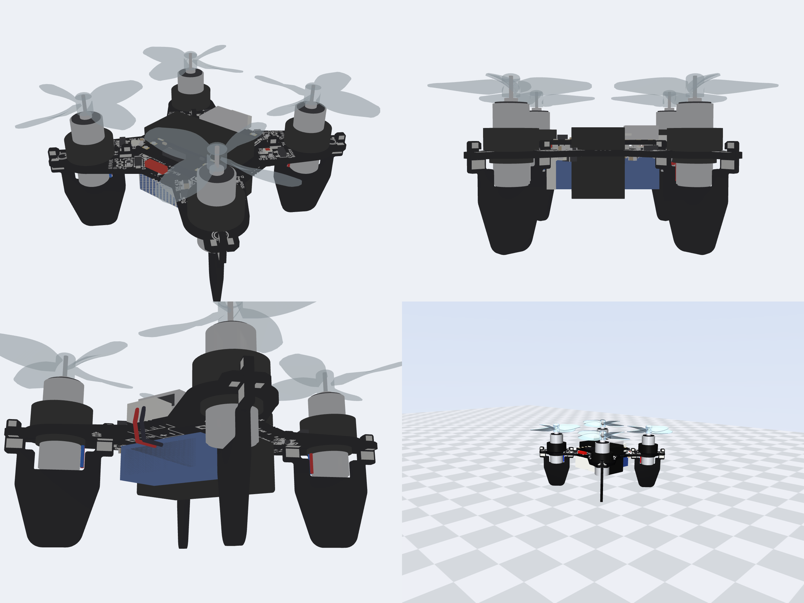

# Hardware e modelo 3D

## E1 Nano v1.5Y

| Item | Valor | Origem |
|---|---|---|
| Controlador | ESP32-S3 SuperMini (ESP32-S3FH4R2) | especificação oficial |
| IMU | MPU-6500 (SPI) | BOM |
| Entre eixos | **50,0 mm** (diagonal motor–motor) | PCB (medido) = especificação |
| PCB | 50,9 × 50,9 × 1,2 mm, X com braços arredondados | contorno extraído do PCB |
| Furo do motor | Ø 8,5 mm (motor + anel de borracha) | PCB |
| Drivers | 4× AO3416 + 4× B5819W (motores escovados) | BOM |
| Regulador | ME6118A33 (SOT-89) | BOM |
| Pernas | 4 placas do próprio painel, verticais, 18,6 mm abaixo da placa | contorno do painel |
| Massa | ~25 g com bateria | especificação oficial |
| Motores | coreless 0716 (Ø7 × 16 mm) | **estimado** pelas fotos e pelo furo |
| Hélices | 31 mm, 4 pás | **estimado** pelas fotos |
| Bateria | LiPo 1S ~250 mAh, embaixo da placa, com velcro | **estimado** |
| Empuxo máx./motor | 0,216 N (≈22 gf) @ ~38 000 rpm | **estimado**: meça e ajuste `max_thrust` |

## Modelo



O modelo 3D foi gerado a partir dos dados reais do PCB (contorno, furos, pads, serigrafia e posição de
cada componente). Os arquivos estão em `e1_description/`:

| Arquivo | Uso |
|---|---|
| `urdf/e1_nano.urdf` | ROS 2 (`package://`), plugins gz-sim MulticopterMotorModel + IMU |
| `urdf/e1_nano_standalone.urdf` | caminhos relativos (PyBullet, Isaac...) |
| `urdf/e1_nano_genesis.urdf` | Genesis `gs.morphs.Drone` (`<properties kf km>`, hélices sem massa) |
| `mjcf/e1_nano.xml` | MuJoCo com atuadores de empuxo e sensores |
| `meshes/visual/*.stl` | malhas em metros, uma por material |
| `meshes/e1_nano_full.glb` | modelo colorido (Blender / visualizadores) |
| `config/e1_nano.yaml` | parâmetros físicos |

Massas e inércias vêm das malhas, com densidade ajustada para somar 25,1 g. O centro de massa fica
1,3 mm abaixo do plano médio do PCB.

## Ordem e sentido dos motores

```
        frente (x)
   FL (3) CW    FR (2) CCW
          \    /
           \  /
           /  \
          /    \
   RL (0) CCW   RR (1) CW
```

Índices = `motors[]` do CF-Drone (`MOTOR_REAR_LEFT = 0` ...). Sentidos vistos de cima, conforme o mixer
(`control.ino`).
