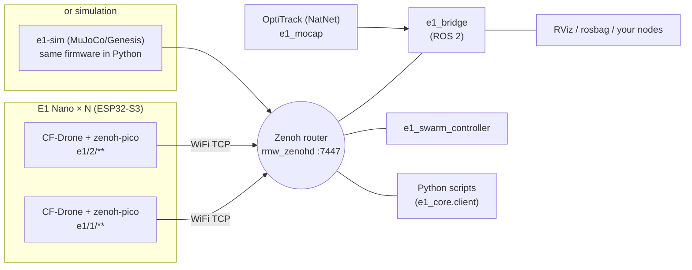

# E1 Nano ROS

**ROS 2 driver, Zenoh firmware, simulation and swarm tools for the ESP32 mini-drone
[Cherglow E1 Nano](https://oshwhub.com/songge8/project_fnvbukbz)**: 50 mm wheelbase, 25 g, ESP32-S3.

<video src="assets/swarm_demo.mp4" controls muted loop playsinline width="100%"></video>

!!! tip "Interactive 3D"
    Replays of the MuJoCo and Genesis simulations, and the drone model with an exploded view, in the
    [**3D viewer**](viewer/index.html).

<iframe src="viewer/" title="E1 Nano 3D viewer" style="width:100%;height:560px;border:1px solid #8884;border-radius:10px"></iframe>

## Contents

| Component | Function |
|---|---|
| **`firmware/`** | Original CF-Drone (submodule) plus the **E1 Zenoh link**: the drone publishes telemetry and receives commands directly on the ROS 2 Zenoh network, with no agent or bridge. |
| **`e1_core`** | ROS-independent Python core: protocol, port of the CF-Drone controller, position control, swarm client and **MuJoCo** and **Genesis** simulators (*software in the loop*). |
| **`e1_bridge`** | ROS 2 driver: a single process serves the whole swarm, with per-drone topics, services and TF and automatic discovery. |
| **`e1_mocap`** | OptiTrack motion capture: pure-Python NatNet client (no SDK), one `PoseStamped` per drone, Y/Z-up handling and tracking diagnostics. A fake Motive in the simulator lets you rehearse the real setup. |
| **`e1_control`** | Position control of N drones, `takeoff`/`land`/`goto` services and example missions (square, formation). |
| **`e1_description`** | 3D model built from the actual PCB: URDF (ROS/Gazebo), MJCF (MuJoCo), URDF for Genesis and meshes. |
| **`e1_msgs`** | Messages and services. |
| **`e1_bringup`** | Launch files for simulation and real flight, Zenoh router configuration and RViz. |
| **`docker/`**, **`compose.yaml`** | Complete environment with a single command, including firmware and documentation builds. |

## Architecture at a glance

ROS 2 uses `rmw_zenoh_cpp`, which has been Tier-1 since Kilted. Therefore **drones, simulator, ROS nodes and scripts
share the same Zenoh router**. Simulation and hardware use exactly the same protocol and the same
API: code tested in the simulator flies on the real drone without changes.
The rationale for this choice is given in [Middleware choice](middleware.md).

## Where to start

1. [Installation](installation.md): Docker or native.
2. [Simulation in 5 minutes](tutorial/01-simulation.md): one drone and then a swarm, without ROS.
3. [ROS 2 + RViz](tutorial/02-ros2.md).
4. [Firmware](tutorial/03-firmware.md) and [real flight](tutorial/04-real-flight.md).

!!! warning "Before flying for real"
    Read [Flight safety](safety.md). The 31 mm propellers can cause injuries, and the E1 Nano has no position
    sensor: autonomous flight requires motion capture (or another external positioning system).

## Credits

Developed and maintained by VeRLab — DCC/UFMG. E1 Nano hardware and CF-Drone firmware by Cherglow (songge8).
