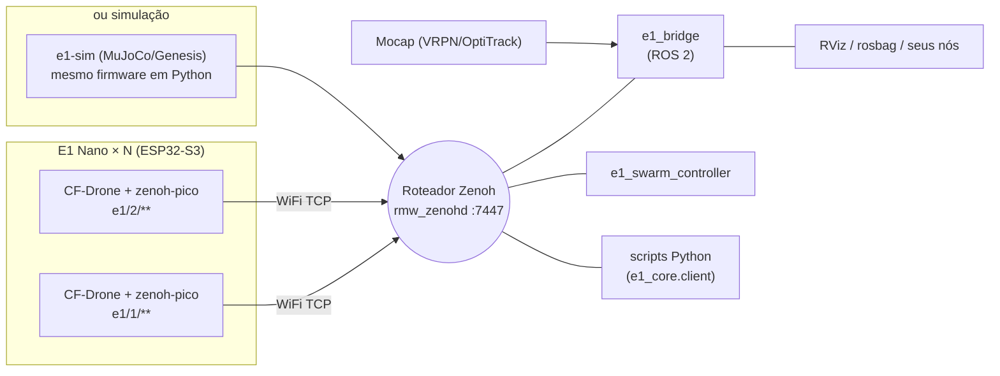

# E1 Nano ROS

**Driver ROS 2, firmware com Zenoh, simulação e ferramentas de enxame para o mini-drone ESP32
[Cherglow E1 Nano](https://oshwhub.com/songge8/project_fnvbukbz)**: 50 mm entre eixos, 25 g, ESP32-S3.

<video src="assets/swarm_demo.mp4" controls muted loop playsinline width="100%"></video>

## O que tem aqui

| Peça | O que faz |
|---|---|
| **`firmware/`** | CF-Drone original (submódulo) mais o **E1 Zenoh link**: o drone publica telemetria e recebe comandos direto na malha Zenoh do ROS 2, sem agente nem ponte. |
| **`e1_core`** | Núcleo em Python, sem ROS: protocolo, porte do controlador do CF-Drone, controle de posição, cliente de enxame e simuladores **MuJoCo** e **Genesis** (*software in the loop*). |
| **`e1_bridge`** | Driver ROS 2: um processo atende o enxame todo, com tópicos, serviços e TF por drone e descoberta automática. |
| **`e1_control`** | Controle de posição de N drones, serviços `takeoff`/`land`/`goto` e missões de exemplo (quadrado, formação). |
| **`e1_description`** | Modelo 3D feito a partir do PCB real: URDF (ROS/Gazebo), MJCF (MuJoCo), URDF para Genesis e malhas. |
| **`e1_msgs`** | Mensagens e serviços. |
| **`e1_bringup`** | Launch de simulação e de voo real, configuração do roteador Zenoh e RViz. |
| **`docker/`**, **`compose.yaml`** | Ambiente completo com um comando, incluindo build do firmware e documentação. |

## Arquitetura em uma figura

O ROS 2 usa `rmw_zenoh_cpp`, que é Tier-1 desde o Kilted. Assim, **drones, simulador, nós ROS e scripts
compartilham o mesmo roteador Zenoh**. Simulação e hardware usam exatamente o mesmo protocolo e a mesma
API: um código testado no simulador voa no drone real sem alterações.
A justificativa da escolha está em [Escolha do middleware](middleware.md).

## Comece por aqui

1. [Instalação](instalacao.md): Docker ou nativo.
2. [Simulação em 5 minutos](tutorial/01-simulacao.md): um drone e depois um enxame, sem ROS.
3. [ROS 2 + RViz](tutorial/02-ros2.md).
4. [Firmware](tutorial/03-firmware.md) e [voo real](tutorial/04-voo-real.md).

!!! warning "Antes de voar de verdade"
    Leia [Segurança de voo](seguranca.md). As hélices de 31 mm machucam, e o E1 Nano não tem sensor de
    posição: voo autônomo exige captura de movimento (ou outro sistema de posicionamento externo).
