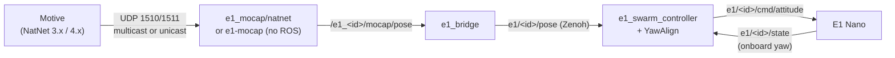

# Motion capture (OptiTrack)

The E1 Nano only estimates its attitude onboard (MPU-6500, no magnetometer). Position flight needs an
external pose source. The stack ships its own **NatNet client** for OptiTrack Motive, written in pure Python, so
no NatNet SDK, VRPN server or extra ROS package is needed. Any other source that publishes
`geometry_msgs/PoseStamped` (Vicon, `vrpn_mocap`, `mocap4r2`, UWB, ArUco) also works through `mocap:=topic`.



## Markers

* **3–4 markers per drone** (3–4 mm, about 0.02 g each). One marker gives neither yaw nor a stable identity.
* Put them on top of the board, outside the propeller discs: arm roots and ESP32 corners.
* Use an **asymmetric** layout with at least 12–15 mm between markers. Give each drone a different layout. About 5–8 distinct layouts fit on a 5 cm board.
* Optional: a 1.5–2 cm mast with one marker on top makes each layout easier to tell apart.

## Motive settings

| Setting | Value |
|---|---|
| Rigid body name | `e1_<id>` (for example `e1_1`, `e1_2`). The name gives the drone id. |
| Rigid body pivot | board centre, drone facing the room's +x when the body is created (FLU: x forward, z up) |
| Streaming → Local interface | the Motive PC's address on the mocap network |
| Streaming → Transmission type | Multicast (default) or Unicast |
| Streaming → Up axis | **Z up** (recommended). With Y up, pass `up_axis:=y`. |
| Camera rate | 120–240 Hz |
| Smoothing / deflection | low; mask reflections |

Use **wired Ethernet** between the Motive PC and the ROS PC. The drones use WiFi; keep the two networks apart.

## Running it

=== "ROS 2"

    ```bash
    ros2 launch e1_bringup real.launch.py ids:="[1,2,3]" \
        mocap:=natnet server_ip:=192.168.1.10 local_ip:=192.168.1.20      # multicast
    # unicast and Motive's default Y-up:
    ros2 launch e1_bringup real.launch.py ids:="[1]" mocap:=natnet server_ip:=192.168.1.10 \
        local_ip:=192.168.1.20 multicast:=false up_axis:=y
    # any other PoseStamped source:
    ros2 launch e1_bringup real.launch.py ids:="[1]" mocap:=topic mocap_topic:="/vrpn_mocap/e1_{id}/pose"
    ```

    `e1_mocap` publishes `/e1_<id>/mocap/pose` and `/e1/mocap/status` (JSON: frame rate, age and
    tracking state per drone), and warns when a drone stops being tracked. Parameters:
    `e1_mocap/config/optitrack.yaml`.

=== "Python only"

    ```bash
    e1-mocap --server 192.168.1.10 --local 192.168.1.20                  # -> e1/<id>/pose on Zenoh
    e1-mocap --server 192.168.1.10 --local 192.168.1.20 --unicast --up y
    ```

Check in RViz (or with `e1-cli status`) that every drone shows up at the right position **and heading**
before you take off.

## Heading: mocap vs. onboard yaw

The drone has no magnetometer, so its onboard yaw starts at an arbitrary value and drifts slowly. The ground controller
computes the attitude command in the mocap frame, but the firmware tracks that command against its own yaw estimate.
Without a correction, a heading error of θ rotates every tilt command by θ, and the position loop spirals (in simulation,
25° is enough to lose 0.7 m on a square; 70° diverges).

`e1_core.control.YawAlign` estimates `d = yaw_firmware − yaw_mocap` from the `state` telemetry (low-pass on the circle)
and sends `Rz(d) · q_cmd`. It is on by default in `e1_swarm_controller` (`align_yaw: true`) and in the Python client.

<iframe src="../viewer/" title="E1 Nano 3D viewer" style="width:100%;height:520px;border:1px solid #8884;border-radius:10px"></iframe>

*Pick "Heading alignment" in the viewer: drone 1 uses `YawAlign`, drone 2 sends raw mocap-frame commands.*

## Rehearsing in simulation

The simulator can act as a fake Motive. It streams ground truth over NatNet, and its onboard heading is offset and drifts,
like on the real drone. The whole real pipeline can then run on one laptop:

```bash
ros2 launch e1_bringup sim.launch.py num:=2 mocap:=true yaw_offset:=60 yaw_drift:=1
# or without ROS
e1-sim -n 2 --natnet 127.0.0.1 --natnet-up y --yaw-offset 60 --yaw-drift 1 &
e1-mocap --server 127.0.0.1 --local 127.0.0.1 --unicast --up y
```

## Troubleshooting

| Symptom | Check |
|---|---|
| `Motive did not answer NAT_CONNECT` | `server_ip`/`local_ip`, firewall (UDP 1510/1511), Motive streaming enabled |
| No frames in multicast | the switch must forward multicast (IGMP); try `multicast:=false` |
| Drone found but upside down or rotated 90° | up axis mismatch: set `up_axis` to Motive's setting |
| Ids missing | rigid body names must match `name_pattern` (`e1_(\d+)`), or use `by_id:=true` with the streaming id |
| Position oscillates | mocap latency/jitter: wired link, 120+ Hz, lower `kp`/`kd` |
