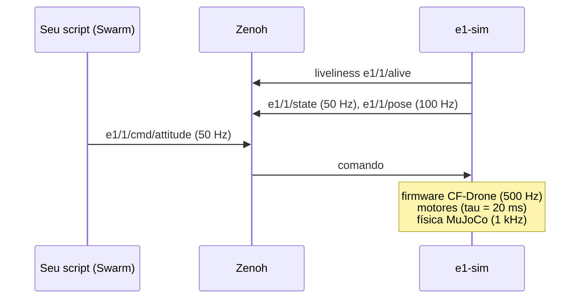

# 1. Simulação em 5 minutos (sem ROS)

O simulador `e1-sim` roda N drones no MuJoCo. Cada drone executa o **mesmo controlador do CF-Drone**
(porte em Python de `control.ino`: ganhos, mixer, modos, armamento e failsafes) e fala o **mesmo
protocolo Zenoh** do firmware real. Do ponto de vista de quem comanda, sim e hardware são indistinguíveis.

## 1.1 Um drone

```bash
# terminal 1: simulador em modo peer (dispensa roteador)
python3 -m e1_core.sim.cli -n 1 --mode peer --listen tcp/127.0.0.1:7447 --connect "" --viewer
# terminal 2
python3 examples/fly_square.py --side 0.6 --z 0.4
```

`--viewer` abre o visualizador do MuJoCo. Sem monitor, use `--record voo.mp4`.

## 1.2 Telemetria e comandos pelo terminal

```bash
e1-cli list                     # drones descobertos (tokens e1/*/alive)
e1-cli status                   # tabela ao vivo: modo, armado, bateria, atitude, motores
e1-cli console 1 "p CTL_TRIM_ROLL 0.01"
e1-cli estop                    # desarma todos (e1/all/cmd/arm)
```

(Use `python3 -m e1_core.cli` se `e1-cli` não estiver no `PATH`.)

## 1.3 Programando com a API Python

```python
from e1_core.client import connect, Swarm
from e1_core.control import Waypoints, square

s = connect('tcp/127.0.0.1:7447')
sw = Swarm(s)                 # descobre os drones sozinho
ids = sw.wait_for(1)
sw.takeoff(0.4)
start = sw[ids[0]].setpoint(sw.now())[0]
sw.follow(ids[0], Waypoints(start, square((0.3, 0.3), 0.6, 0.4)))
sw.land()
sw.close()
```

O `Swarm` roda um laço de 50 Hz. Para cada drone ele lê `e1/<id>/pose` (verdade de campo no simulador,
mocap no real), calcula a atitude e o empuxo com `PositionController` e publica `e1/<id>/cmd/attitude`.

## 1.4 Um enxame

```bash
python3 -m e1_core.sim.cli -n 6 --layout grid --mode peer --listen tcp/127.0.0.1:7447 --connect ""
python3 examples/swarm_formation.py --n 6
```

Para gerar um vídeo sem depender do tempo real (útil em servidores sem GPU):

```bash
MUJOCO_GL=egl python3 examples/render_demo.py --n 6 --out swarm.mp4
```

## O que está acontecendo por baixo



Próximo: [ROS 2 + RViz](02-ros2.md).
