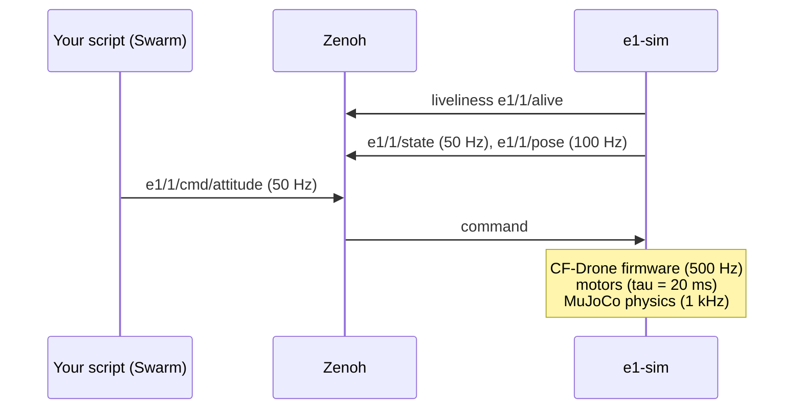

# 1. Simulation in 5 minutes (without ROS)

The `e1-sim` simulator runs N drones in MuJoCo. Each drone executes the **same controller as CF-Drone**
(a Python port of `control.ino`: gains, mixer, modes, arming and failsafes) and speaks the **same
Zenoh protocol** as the real firmware. From the commanding side, simulation and hardware are indistinguishable.

## 1.1 A single drone

```bash
# terminal 1: simulator in peer mode (no router needed)
python3 -m e1_core.sim.cli -n 1 --mode peer --listen tcp/127.0.0.1:7447 --connect "" --viewer
# terminal 2
python3 examples/fly_square.py --side 0.6 --z 0.4
```

`--viewer` opens the MuJoCo viewer. Without a display, use `--record flight.mp4`.

## 1.2 Telemetry and commands from the terminal

```bash
e1-cli list                     # discovered drones (tokens e1/*/alive)
e1-cli status                   # live table: mode, armed, battery, attitude, motors
e1-cli console 1 "p CTL_TRIM_ROLL 0.01"
e1-cli estop                    # disarms all drones (e1/all/cmd/arm)
```

(Use `python3 -m e1_core.cli` if `e1-cli` is not on the `PATH`.)

## 1.3 Programming with the Python API

```python
from e1_core.client import connect, Swarm
from e1_core.control import Waypoints, square

s = connect('tcp/127.0.0.1:7447')
sw = Swarm(s)                 # discovers the drones automatically
ids = sw.wait_for(1)
sw.takeoff(0.4)
start = sw[ids[0]].setpoint(sw.now())[0]
sw.follow(ids[0], Waypoints(start, square((0.3, 0.3), 0.6, 0.4)))
sw.land()
sw.close()
```

`Swarm` runs a 50 Hz loop. For each drone it reads `e1/<id>/pose` (ground truth in the simulator,
mocap on hardware), computes attitude and thrust with `PositionController` and publishes `e1/<id>/cmd/attitude`.

## 1.4 A swarm

```bash
python3 -m e1_core.sim.cli -n 6 --layout grid --mode peer --listen tcp/127.0.0.1:7447 --connect ""
python3 examples/swarm_formation.py --n 6
```

To render a video independently of real time (useful on servers without a GPU):

```bash
MUJOCO_GL=egl python3 examples/render_demo.py --n 6 --out swarm.mp4
```

## What happens underneath



Next: [ROS 2 + RViz](02-ros2.md).
